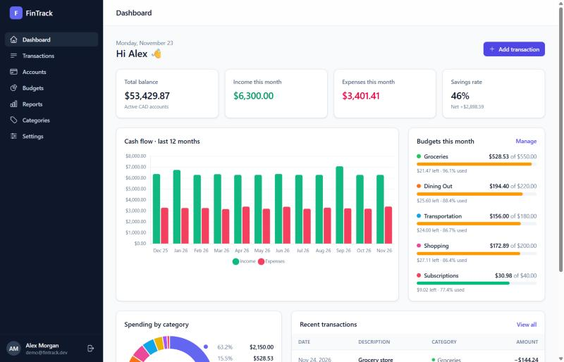
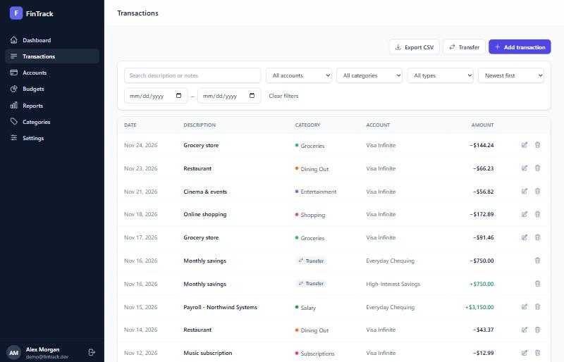
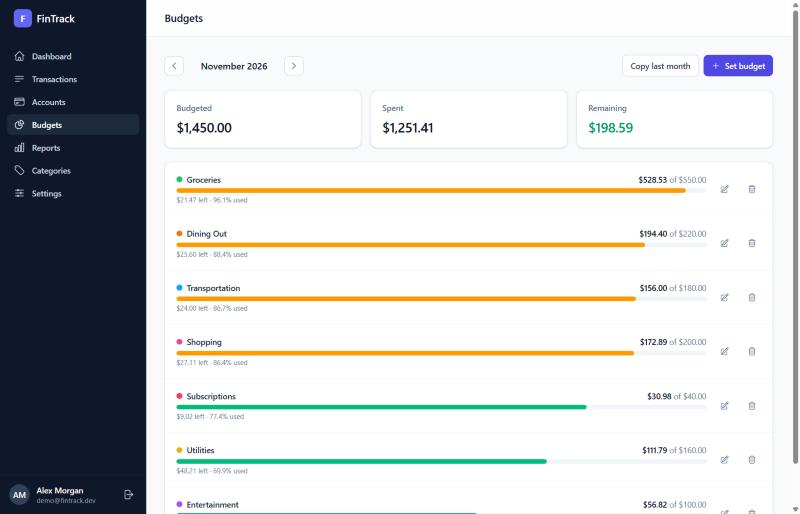
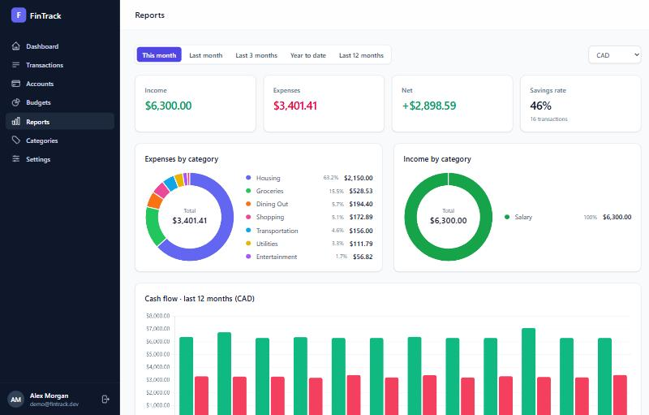
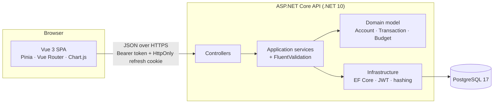

# FinTrack — Personal Finance Management

[](https://github.com/Samgar-kz/FinTrack/actions/workflows/ci.yml)


FinTrack is a full-stack personal finance application: multi-currency accounts, income and expense tracking,
transfers between accounts, monthly budgets and reports. It is built the way I build production banking
software — a layered ASP.NET Core API with a rich domain model, PostgreSQL, automated tests against a real
database, Docker and CI — and a typed Vue 3 front end.



## Features

- **Accounts** — chequing, savings, credit card, cash and investment accounts in CAD, USD, EUR, GBP or KZT; archive instead of delete once an account has history.
- **Transactions** — income and expenses with categories, notes, full-text search, filters, sorting, pagination and CSV export.
- **Transfers** — move money between your own accounts; both legs are created and deleted together in one database transaction.
- **Budgets** — monthly limits per expense category with live progress, warnings at 85 % and "copy last month".
- **Reports** — income vs. expenses, savings rate, spending by category and a 12-month cash-flow chart, per currency.
- **Security** — JWT access tokens, rotating refresh tokens in HttpOnly cookies with reuse detection, rate-limited auth endpoints, role-based admin area.
- **Demo data** — a seeded demo user with 12 months of realistic transactions, so the app is explorable immediately.

| Transactions | Budgets | Reports |
| --- | --- | --- |
|  |  |  |

## Quick start

**Run everything with Docker** (PostgreSQL + API + UI):

```bash
docker compose up --build
```

| What | URL |
| --- | --- |
| Web app | http://localhost:8080 |
| API reference (Scalar / OpenAPI) | http://localhost:5080/scalar |
| Health check | http://localhost:5080/health |

Sign in with the demo account **demo@fintrack.dev / Demo123!** (or **admin@fintrack.dev / Admin123!** for the admin area).
These credentials exist only because the local compose file enables demo seeding.

<details>
<summary><strong>Run without Docker</strong> (for development)</summary>

Prerequisites: .NET 10 SDK, Node.js 24+, PostgreSQL 17 with a `fintrack` database owned by user `fintrack` / password `fintrack`.

```bash
# API on http://localhost:5080 — applies migrations and seeds demo data in Development
dotnet run --project backend/src/FinTrack.Api

# UI on http://localhost:5173 — proxies /api to the backend
cd frontend
npm install
npm run dev
```
</details>

## Architecture



The backend follows a pragmatic **Clean Architecture** split into four projects:

| Project | Responsibility |
| --- | --- |
| `FinTrack.Domain` | Entities and business rules with no framework dependencies. Balances can only change through domain methods, so an account balance always equals its opening balance plus its postings. |
| `FinTrack.Application` | Use cases (services), DTOs, validation, the `IAppDbContext` abstraction and reporting queries. |
| `FinTrack.Infrastructure` | EF Core + Npgsql persistence, entity configurations, migrations, JWT issuing, password hashing, demo-data seeding. |
| `FinTrack.Api` | HTTP endpoints, authentication, authorisation policies, rate limiting, problem-details error handling, OpenAPI. |

### Design decisions

- **Money is `decimal(18,2)` and always positive.** Direction comes from the transaction type, and a database check constraint rejects non-positive amounts.
- **Optimistic concurrency on balances.** `Account` uses PostgreSQL's `xmin` system column as a row version, so two concurrent postings to the same account cannot silently overwrite each other — the loser gets `409 Conflict`.
- **No invented exchange rates.** Reports are always computed for a single currency; transfers between currencies are rejected rather than converted with a made-up rate.
- **Refresh-token rotation with reuse detection.** Refresh tokens are random 512-bit values stored only as SHA-256 hashes. Each refresh rotates the token; replaying an old one revokes every session of that user.
- **Access tokens never touch `localStorage`.** The SPA keeps the access token in memory and restores the session from the HttpOnly, `SameSite=Strict` refresh cookie after a reload.
- **Secure by default.** A fallback authorisation policy requires authentication on every endpoint unless it is explicitly `[AllowAnonymous]`; other users' data returns `404`, never `403`, to avoid leaking existence.
- **Consistent errors.** Validation, business-rule, not-found, conflict and concurrency failures are mapped to RFC 9457 problem details (`400`, `422`, `404`, `409`).
- **No commercial-licence dependencies.** Mapping is explicit and use cases are plain services (no MediatR/AutoMapper).

## API overview

| Method | Endpoint | Description |
| --- | --- | --- |
| `POST` | `/api/auth/register`, `/login`, `/refresh`, `/logout` | Sign-up, sign-in and session management |
| `GET` `PUT` | `/api/auth/me` | Current user profile and base currency |
| `GET` `POST` `PUT` `DELETE` | `/api/accounts` | Accounts, plus `POST /{id}/archive` and `/{id}/restore` |
| `GET` `POST` `PUT` `DELETE` | `/api/categories` | Income and expense categories |
| `GET` `POST` `PUT` `DELETE` | `/api/transactions` | Search with filters and paging; `GET /export` returns CSV |
| `POST` | `/api/transfers` | Transfer between two accounts |
| `GET` `PUT` `DELETE` | `/api/budgets` | Monthly budgets with spending; `POST /copy-previous` |
| `GET` | `/api/reports/summary`, `/categories`, `/cash-flow` | Reporting |
| `GET` | `/api/admin/users`, `/api/admin/stats` | Admin only |

The full, interactive reference is served at `/scalar` when `OpenApi:Enabled` is true.

## Testing

```bash
dotnet test backend/FinTrack.slnx          # unit + integration tests
cd frontend && npm test                    # Vitest unit/component tests
```

- **Unit tests (xUnit)** cover the domain rules (balances, transfers, budgets, categories), validators, CSV export and token/password services.
- **Integration tests** boot the real API with `WebApplicationFactory` against a **PostgreSQL container started by Testcontainers**, exercising migrations, SQL translation, authentication flows (including refresh-token reuse detection), data isolation between users, reports and admin authorisation. Set `FINTRACK_TEST_DATABASE` to a connection string to run them against an existing PostgreSQL server instead of Docker.
- **Front-end tests (Vitest + Vue Test Utils)** cover the HTTP client's silent token refresh, the auth store and components.
- **CI (GitHub Actions)** builds and tests the backend and frontend, lints and type-checks the UI, and builds both Docker images on every push and pull request.

## Tech stack

| Layer | Technologies |
| --- | --- |
| Backend | C# 14, .NET 10, ASP.NET Core, EF Core 10, Npgsql, FluentValidation, JWT bearer auth, ASP.NET Core rate limiting, OpenAPI + Scalar |
| Database | PostgreSQL 17, EF Core migrations, snake_case naming, check constraints, `xmin` concurrency |
| Frontend | Vue 3 (Composition API, `<script setup>`), TypeScript, Pinia, Vue Router, Tailwind CSS 4, Chart.js, Vite |
| Testing | xUnit, WebApplicationFactory, Testcontainers, Vitest, Vue Test Utils |
| DevOps | Docker (multi-stage, non-root), Docker Compose, Nginx, GitHub Actions |

## Project structure

```
FinTrack/
├── backend/
│   ├── src/
│   │   ├── FinTrack.Domain/          # entities and business rules
│   │   ├── FinTrack.Application/     # services, DTOs, validators
│   │   ├── FinTrack.Infrastructure/  # EF Core, migrations, security, seeding
│   │   └── FinTrack.Api/             # controllers, auth, error handling
│   └── tests/
│       ├── FinTrack.UnitTests/
│       └── FinTrack.IntegrationTests/
├── frontend/                         # Vue 3 + TypeScript SPA
├── docker-compose.yml
└── .github/workflows/ci.yml
```

## Roadmap

- Recurring transactions (rent, salary, subscriptions) generated by a background job
- CSV/OFX bank statement import with duplicate detection
- Audit log of changes to financial records
- Exchange-rate provider for consolidated multi-currency net worth

## Author

**Samgar Abdikozha** — .NET / full-stack software engineer with experience building enterprise banking systems.
[LinkedIn](https://www.linkedin.com/in/samgar-abdikozha/) · [GitHub](https://github.com/Samgar-kz)

Licensed under the [MIT License](LICENSE).
